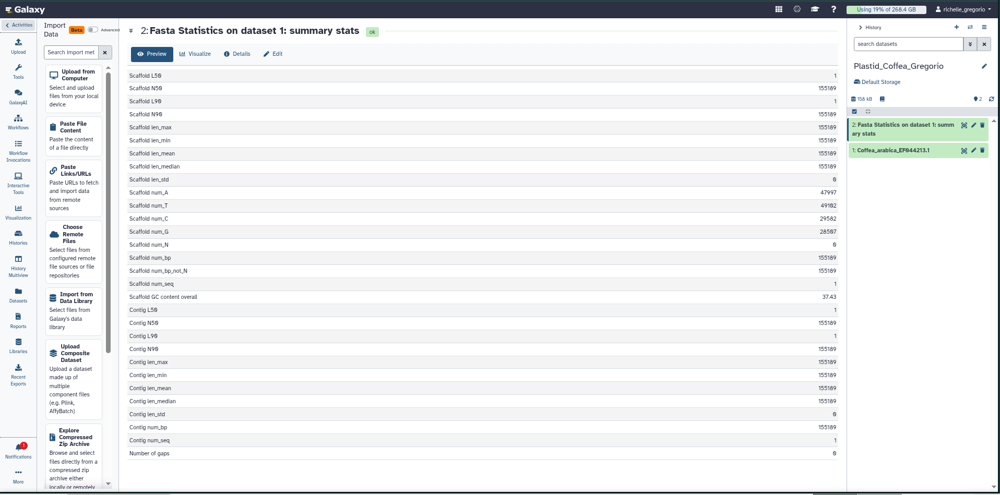

## Figure Description

*This section shows the figure generated from the Galaxy Results history of mine(Gregorio, Richelle O.)*

----

*Figure 1. Overview of the Galaxy workflow history showing the FASTA statistics output for the Coffea arabica plastid genome.*

---

The summary statistics confirm the structural integrity and completeness of the retrieved dataset. The absence of internal sequence gaps, alongside a total length of 155,189 base pairs across a single contig, verifies that the sequence represents an intact plastid genome suitable for downstream structural and comparative analyses.
