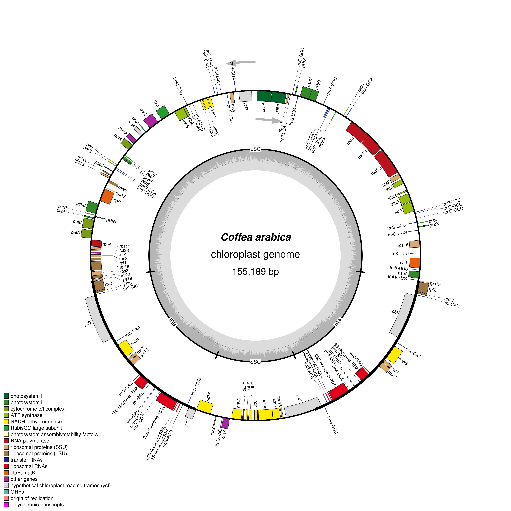

# Plastid Genome Visualization: Visualize Plastid Genome Structure

## Genome Overview
* **Scientific Name:** *Coffea arabica*
* **NCBI Accession Number:** [`EF044213.1`](https://www.ncbi.nlm.nih.gov/nuccode/EF044213.1)
* **Plastid Genome Length:** 155,189 bp
* **Source of Genome File:** [NCBI Nucleotide Database](https://www.ncbi.nlm.nih.gov/nuccode/EF044213.1)
* **Software Used:** [OGDRAW (OrganellarGenomeDRAW) v1.3.1](https://chlorobox.mpimp-golm.mpg.de/OGDraw.html)

## Methods
1. **Downloading the Data:** The fully annotated GenBank record (`EF044213.1.gb`) for the *Coffea arabica* plastid genome was obtained directly from the [NCBI Nucleotide database](https://www.ncbi.nlm.nih.gov/nuccode/EF044213.1).
2. **Generating the Map:** The downloaded GenBank file was uploaded to the [OGDRAW web tool](https://chlorobox.mpimp-golm.mpg.de/OGDraw.html) hosted by the Max Planck Institute of Molecular Plant Physiology.
3. **Setting Up Parameters:**
   * **Map Mode:** Standard map mode
   * **Genome Map Type:** Circular
   * **Sequence Source:** Plastid
   * **Inverted Repeats:** Automatic detection
   * **GC Content Graph:** Turned on (displayed as the inner ring)
   * **Transcription Direction:** Enabled (showing gene arrows and orientations)
   * **Full Legend:** Included
   * **Intron-Containing Genes:** Flagged with an asterisk (*)
4. **Saving and Organizing:** The generated circular map image (`Coffea_arabica_EF044213.1.jpg`) was saved into the repository's `figures/` directory, and all associated project files were organized to fulfill the lab specifications.

## Plastid Genome Map

**Figure 1. Circular genome map of *Coffea arabica* ([`EF044213.1`](https://www.ncbi.nlm.nih.gov/nuccode/EF044213.1)).** This map highlights the classic four-part (quadripartite) structure composed of the Large Single-Copy (LSC) region, Small Single-Copy (SSC) region, and two Inverted Repeats. Genes drawn on the inside of the ring are transcribed in a clockwise direction, whereas genes on the outside are transcribed counterclockwise. The inner gray graph tracks GC content across the 155,189 bp genome length.

## Main Structural Features Observed

The *Coffea arabica* plastid genome clearly displays the typical four-part layout found in most land plants, spanning a total length of 155,189 base pairs. It consists of a Large Single-Copy (LSC) region and a Small Single-Copy (SSC) region, separated by two identical Inverted Repeat regions. Examination of the inner GC content graph shows regional variation, with peaks remaining noticeably higher and more stable within the IR regions due to the high concentration of rRNA and tRNA genes. Finally, gene arrows and orientations confirm that transcription occurs across both DNA strands throughout various functional gene clusters.

## Lab Answers File

* Detailed responses to all ten lab questions can be found in the [Lab Answers File](answers/Lab_plastid_genome_answers.md).

## References

* Greiner, S., Lehwark, P., & Bock, R. (2019). OrganellarGenomeDRAW (OGDRAW) version 1.3.1: expanded toolkit for the graphical visualization of organellar genomes. *Nucleic Acids Research*, 47(W1), W59–W64. https://doi.org/10.1093/nar/gkz238
* Max Planck Institute of Molecular Plant Physiology. (n.d.). *OGDRAW - OrganellarGenomeDRAW*. CHLOROBOX. https://chlorobox.mpimp-golm.mpg.de/OGDraw.html
* National Center for Biotechnology Information (NCBI). (n.d.). *Coffea arabica chloroplast, complete genome* (Accession No. EF044213.1). U.S. National Library of Medicine. https://www.ncbi.nlm.nih.gov/nuccode/EF044213.1
